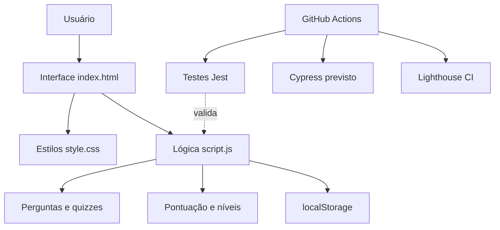

# 🤖 GitBot — Aprenda Git na Prática

Aplicação web educativa para aprender e praticar comandos **Git** por meio de um chat interativo, perguntas, dicas e quizzes. O projeto também demonstra testes automatizados e uma pipeline de integração contínua com GitHub Actions.

Projeto acadêmico de Análise e Desenvolvimento de Sistemas (ADS).

---

## 1. Objetivo e problema

**Objetivo:** ajudar iniciantes a aprender e memorizar comandos Git com desafios práticos, feedback e pontuação.

**Problema:** memorizar comandos Git e saber quando utilizá-los pode ser difícil para quem está começando. A prática guiada ajuda a reforçar o aprendizado.

**Escopo**
- **Incluído:** interface web, chat educativo, perguntas de texto, quizzes, dicas, correção de respostas, pontuação, níveis, reinício da conversa e armazenamento local do progresso.
- **Fora do escopo:** execução real de comandos Git, autenticação, contas de usuários, sincronização em nuvem, API própria e banco de dados remoto.

## 2. Requisitos

### Funcionais

| ID | Requisito |
|---|---|
| RF01 | Apresentar perguntas e desafios sobre comandos Git. |
| RF02 | Permitir respostas digitadas no chat. |
| RF03 | Oferecer perguntas de múltipla escolha. |
| RF04 | Conferir respostas e informar se estão corretas. |
| RF05 | Oferecer dicas para as perguntas. |
| RF06 | Somar pontos e atualizar o nível do usuário. |
| RF07 | Permitir reiniciar a conversa e a pontuação. |
| RF08 | Salvar e recuperar o progresso pelo navegador. |
| RF09 | Permitir voltar à tela inicial. |

### Não funcionais

| ID | Requisito |
|---|---|
| RNF01 | Interface web desenvolvida em HTML, CSS e JavaScript. |
| RNF02 | Funcionamento em navegadores modernos, sem backend obrigatório. |
| RNF03 | Organização simples entre estrutura, estilos e lógica. |
| RNF04 | Armazenamento local via `localStorage`. |
| RNF05 | Testes unitários com Jest. |
| RNF06 | Pipeline de CI no GitHub Actions para testes unitários, integração e performance. |

**Diferenciais:** ensino em formato de conversa, dicas progressivas, quizzes e sistema de pontuação e níveis.

## 3. Tecnologias

| Item | Detalhe |
|---|---|
| Interface | HTML5 e CSS3 |
| Lógica | JavaScript no navegador |
| Persistência | `localStorage` |
| Dependências e scripts de teste | Node.js e npm |
| Testes unitários | Jest 29 |
| Testes de integração previstos | Cypress 13 |
| Performance e acessibilidade | Lighthouse CI |
| Integração contínua | GitHub Actions |
| Controle de versão | Git e GitHub |

## 4. Arquitetura



A arquitetura é **frontend estática**, sem servidor de aplicação próprio. A interface chama as funções de `script.js`, que gerenciam o chat, as respostas e a pontuação. O navegador armazena o progresso localmente.

| Componente | Responsabilidade |
|---|---|
| `index.html` | Estrutura da página e elementos da interface. |
| `style.css` | Aparência e organização visual. |
| `script.js` | Perguntas, chat, dicas, respostas, pontuação, níveis e progresso. |
| `tests/unit/gameLogic.test.js` | Testes unitários existentes. |
| `.github/workflows/pipeline.yml` | Jobs de integração contínua. |
| `.lighthouserc.json` | Configuração das verificações Lighthouse CI. |

## 5. Estrutura de pastas

```text
GitBot-main/
├── .github/
│   └── workflows/
│       └── pipeline.yml
├── tests/
│   └── unit/
│       └── gameLogic.test.js
├── .lighthouserc.json
├── index.html
├── style.css
├── script.js
├── package.json
├── package-lock.json
└── README.md
```

## 6. Funcionamento do sistema

1. O usuário abre a página inicial e inicia o GitBot.
2. O bot apresenta uma pergunta sobre Git.
3. O usuário responde digitando um comando ou selecionando uma alternativa.
4. O sistema avalia a resposta e fornece feedback.
5. O usuário pode solicitar dicas para resolver desafios.
6. Os acertos geram pontos, que determinam o nível exibido.
7. O progresso pode ser armazenado no navegador.

**Exemplos de comandos abordados:** `git status`, `git branch feature`, `git init`, `git push` e `git add .`.

## 7. Pré-requisitos

- Navegador moderno (Chrome, Edge ou Firefox).
- **Node.js 18** e npm para instalar dependências e executar testes (a pipeline utiliza Node.js 18).
- Git, caso deseje clonar o repositório.
- Opcional: servidor HTTP local para testes e execução via `localhost`.

Confira as instalações com `node -v`, `npm -v` e `git --version`.

## 8. Instalação, configuração e execução

### 1. Obter o projeto

```bash
git clone URL_DO_SEU_REPOSITORIO
cd GitBot-main
```

Substitua a URL pelo endereço real do repositório. Também é possível baixar e extrair o ZIP.

### 2. Instalar as dependências de desenvolvimento

```bash
npm ci
```

### 3. Executar a interface

Abra `index.html` em um navegador. Como alternativa, para servir a aplicação localmente:

```bash
npx http-server -p 8080 .
```

Acesse `http://localhost:8080/index.html`. O comando acima pode solicitar a instalação do pacote `http-server` caso não esteja disponível.

**Configuração:** a aplicação web não exige servidor de banco de dados nem credenciais. Os scripts de teste estão no `package.json`.

## 9. APIs, banco de dados e variáveis de ambiente

**API:** não se aplica. O GitBot não expõe endpoints HTTP próprios.

**Banco de dados:** não utiliza banco relacional ou remoto. O progresso é armazenado no `localStorage` do navegador, com a chave `gitbot_progress`.

**Variáveis de ambiente:** não são necessárias para o funcionamento básico da interface. A configuração da pipeline e do Lighthouse está nos arquivos do repositório.

## 10. Organização da lógica

| Função ou estrutura | Responsabilidade |
|---|---|
| `questions` | Conjunto de perguntas, respostas e dicas. |
| `startApp()` | Abre a tela do chat. |
| `askQuestion()` | Apresenta o desafio atual. |
| `sendMessage()` | Processa a mensagem digitada. |
| `checkAnswer()` | Confere a resposta. |
| `requestHint()` | Fornece dicas. |
| `addScore()` | Atualiza a pontuação. |
| `updateScoreUI()` | Atualiza pontos, nível e progresso visual. |
| `resetChat()` | Reinicia a conversa. |
| `saveProgress()` / `loadProgress()` | Salvam e recuperam o progresso local. |

## 11. Testes

O `package.json` define comandos independentes:

| Tipo | Comando | Situação no ZIP analisado |
|---|---|---|
| Unitário | `npm run test:unit` | Existe arquivo Jest em `tests/unit/`. |
| Integração | `npm run test:integration` | Cypress está configurado, mas o ZIP não contém testes em `cypress/e2e/`. |
| Performance | `npm run test:performance` | Lighthouse CI está configurado em `.lighthouserc.json`. |
| Todos | `npm run test:all` | Executa os três comandos em sequência; pode falhar na etapa de integração sem testes Cypress. |

Para performance, sirva a página em `http://localhost:8080/index.html` antes de executar o Lighthouse, conforme a configuração atual.

### Casos de teste manuais

| Ação | Resultado esperado |
|---|---|
| Iniciar o GitBot | Chat exibe mensagem inicial e primeira pergunta. |
| Responder `git status` à pergunta inicial | Resposta reconhecida como correta. |
| Solicitar dica | Bot apresenta uma dica para a pergunta atual. |
| Responder incorretamente | Bot informa que a resposta não está correta. |
| Acertar desafios | Pontuação e nível são atualizados conforme as regras. |
| Reiniciar conversa | Chat e pontuação são reiniciados. |

### Integração contínua

O workflow `.github/workflows/pipeline.yml` é acionado por **push** e **pull request** nas branches `main` e `master`. Possui jobs para Jest, Cypress e Lighthouse CI.

**Limitações atuais:** os jobs de Cypress e Lighthouse usam `|| true`, permitindo que terminem sem marcar falha mesmo quando o comando de teste falha. Além disso, não há arquivos Cypress no ZIP. Para uma CI que bloqueie alterações com falhas, é necessário implementar os testes de integração e remover esses tratamentos.

## 12. Deploy

O GitBot é uma aplicação web estática. Para disponibilizá-la, publique `index.html`, `style.css` e `script.js` em uma hospedagem de sites estáticos, como GitHub Pages.

Procedimento sugerido com GitHub Pages:
1. Envie o projeto ao GitHub.
2. No repositório, abra **Settings → Pages**.
3. Selecione a branch e a pasta que contêm `index.html`.
4. Salve e aguarde a publicação.
5. Acesse a URL fornecida pelo GitHub e teste o chat.

Não há deploy de API nem migração de banco de dados.

## 13. Boas práticas e limitações

- Mantenha os arquivos de interface e testes organizados.
- Não publique `node_modules/` no repositório; utilize `.gitignore`.
- Não armazene senhas ou dados sensíveis no código ou no `localStorage`.
- O progresso salvo no navegador não é sincronizado entre dispositivos.
- As respostas são avaliadas pela lógica implementada; o sistema **não executa** comandos Git reais.
- Complete os testes Cypress antes de afirmar que os três tipos de teste estão implementados e passando.

## 14. Entregáveis

- Código-fonte do GitBot.
- `README.md` com documentação do projeto.
- Configuração de testes e pipeline de CI.
- Demonstração da aplicação web e dos resultados dos testes disponíveis.
