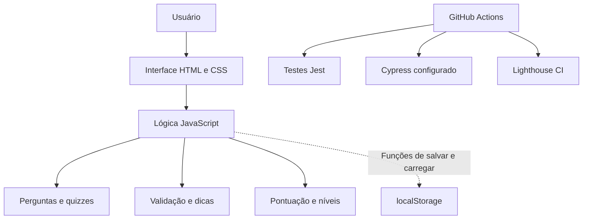
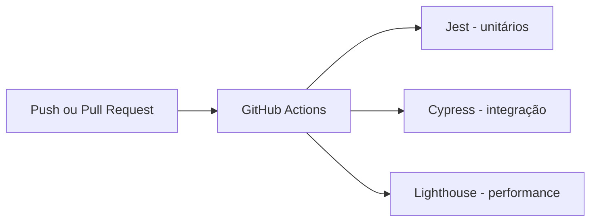

<div align="center">

# 🤖 GitBot — Aprenda Git na Prática

**Aprenda comandos Git com perguntas, dicas e desafios interativos.**
Aplicação web educativa para aprender e praticar comandos Git por meio de um chat interativo, perguntas, dicas e quizzes. O projeto também demonstra testes automatizados e uma pipeline de integração contínua com GitHub Actions.

Projeto acadêmico de Análise e Desenvolvimento de Sistemas (ADS).

## 📖 1. Objetivo, problema e escopo

### 🎯 Objetivo

O **GitBot** é uma aplicação web educativa que ensina comandos Git por meio de uma conversa interativa. O usuário responde a desafios, recebe dicas, ganha pontos e acompanha seu nível de aprendizado.

### 💡 Problema que pretende resolver

Quem está começando a utilizar Git pode ter dificuldade para **lembrar os comandos** e **identificar quando utilizá-los**. Em vez de apenas ler uma lista de comandos, o GitBot permite praticar e receber feedback imediatamente.

### 📌 Escopo do projeto

| ✅ Incluído | 🚫 Fora do escopo |
|---|---|
| Página inicial e chat educativo | Executar comandos Git no computador do usuário |
| Perguntas digitadas e quiz de alternativas | Autenticação e cadastro de contas |
| Correção de respostas e dicas progressivas | Banco de dados em servidor |
| Pontuação, níveis e barra de progresso | API própria ou integração com GitHub |
| Reinício da conversa e retorno à tela inicial | Sincronização de progresso entre dispositivos |
| Funções de armazenamento local presentes no código | Inteligência artificial generativa para respostas livres |

> **Importante:** o GitBot utiliza perguntas e respostas previamente definidas em JavaScript. Não é um chatbot com IA generativa.

---

## 🧾 2. Requisitos do sistema

### Requisitos funcionais

| ID | Requisito |
|---|---|
| **RF01** | Exibir perguntas sobre comandos Git. |
| **RF02** | Receber respostas digitadas pelo usuário. |
| **RF03** | Apresentar perguntas de múltipla escolha. |
| **RF04** | Verificar a resposta e mostrar se está correta ou incorreta. |
| **RF05** | Oferecer dicas progressivas e, após esgotá-las, mostrar o gabarito. |
| **RF06** | Somar 10 pontos por resposta correta. |
| **RF07** | Atualizar o nível e a barra de progresso. |
| **RF08** | Permitir reiniciar a conversa e a pontuação. |
| **RF09** | Permitir retornar à tela inicial e encerrar a conversa. |
| **RF10** | Disponibilizar funções para salvar e carregar progresso no navegador. **A chamada automática dessas funções ainda precisa ser integrada ao fluxo de uso.** |

### Requisitos não funcionais

| ID | Requisito |
|---|---|
| **RNF01** | Interface web construída com HTML5, CSS3 e JavaScript. |
| **RNF02** | Execução em navegador moderno, sem backend próprio. |
| **RNF03** | Separação entre conteúdo, apresentação e lógica. |
| **RNF04** | Uso de `localStorage` para armazenamento local quando as funções forem acionadas. |
| **RNF05** | Testes unitários com Jest. |
| **RNF06** | Pipeline de CI no GitHub Actions para verificar testes e qualidade. |
| **RNF07** | Interface com feedback claro ao usuário. |

---

## 🛠️ 3. Tecnologias utilizadas

| Tecnologia | Para que serve no GitBot |
|---|---|
| **HTML5** | Cria a estrutura da página, do chat, dos botões e dos campos. |
| **CSS3** | Define cores, layout e aparência da interface. |
| **JavaScript** | Controla perguntas, respostas, dicas, pontuação e navegação. |
| **localStorage** | Permite guardar dados no navegador; a integração automática está pendente. |
| **Node.js + npm** | Instalam e executam as ferramentas de teste. |
| **Jest 29** | Executa testes unitários. |
| **Cypress 13** | Ferramenta configurada para testes de integração; os testes Cypress ainda não foram incluídos. |
| **Lighthouse CI** | Avalia desempenho e acessibilidade. |
| **GitHub Actions** | Executa a pipeline ao enviar alterações ao repositório. |
| **Git / GitHub** | Versionamento e hospedagem do código. |
| **Font Awesome (CDN)** | Disponibiliza ícones usados na interface. |

---

## 🏗️ 4. Arquitetura e componentes

O GitBot usa uma **arquitetura frontend estática**: o navegador carrega HTML, CSS e JavaScript e processa as interações localmente. Não existe servidor de API nem banco de dados remoto.



| Arquivo / componente | Responsabilidade |
|---|---|
| `index.html` | Elementos visuais, página inicial, chat e botões. |
| `style.css` | Estilos, cores e organização visual. |
| `script.js` | Banco de perguntas, validação, dicas, pontos, níveis e navegação. |
| `tests/unit/gameLogic.test.js` | Testes unitários da comparação de respostas e dos níveis. |
| `package.json` | Dependências e comandos npm. |
| `.github/workflows/pipeline.yml` | Configuração dos jobs da CI. |
| `.lighthouserc.json` | Configuração de desempenho e acessibilidade. |

### 📁 5. Estrutura de pastas

```text
GitBot-main/
├── .github/
│   └── workflows/
│       └── pipeline.yml       # Pipeline de integração contínua
├── tests/
│   └── unit/
│       └── gameLogic.test.js  # Testes unitários
├── .lighthouserc.json         # Configuração Lighthouse
├── index.html                 # Página principal
├── style.css                  # Estilos visuais
├── script.js                  # Regras do GitBot
├── package.json               # Scripts e dependências
├── package-lock.json          # Versões das dependências
└── README.md                  # Esta documentação
```

---

## 🎮 6. Como utilizar o GitBot

1. Abra a página `index.html` no navegador.
2. Na tela inicial, clique para iniciar a experiência.
3. Leia a pergunta que aparece no chat.
4. Digite a resposta no campo de mensagem e envie com **Enter** ou selecione uma alternativa, quando for quiz.
5. Se errar, tente novamente ou solicite uma **dica**. Depois de todas as dicas, o bot pode revelar a resposta e avançar.
6. Ao acertar, você ganha **10 pontos** e avança para o próximo desafio.
7. Acompanhe sua pontuação e seu nível. Use **Reiniciar Conversa** para começar de novo.

### Exemplos de desafios

| Pergunta | Resposta esperada |
|---|---|
| Como ver arquivos modificados? | `git status` |
| Como criar a branch `feature`? | `git branch feature` |
| Como iniciar um repositório? | `git init` (alternativa **B** no quiz) |
| Como enviar commits ao remoto? | `git push` |
| Como adicionar todos os arquivos à staging area? | `git add .` |

**Níveis definidos no código:** Iniciante (0 pontos), Aprendiz (20), Desenvolvedor (40), Git Expert (60) e Git Master (80). A versão enviada contém **cinco desafios**, portanto uma rodada perfeita alcança **50 pontos**; os dois níveis mais altos não são atingidos nessa rodada.

---

## 🚀 7. Instalação, configuração e execução

### 7.1 Pré-requisitos

**Para apenas usar o GitBot:** navegador atualizado, como Chrome, Edge ou Firefox.

**Para desenvolver e testar:** Git, Node.js e npm. A pipeline do repositório utiliza **Node.js 18**; para reproduzir o ambiente da CI, use essa versão.

Confira se as ferramentas estão instaladas:

```bash
node -v
npm -v
git --version
```

### 7.2 Obter o projeto

**Opção A — baixar ZIP:** no GitHub, clique em **Code → Download ZIP**, extraia e abra a pasta.

**Opção B — clonar:** copie o endereço HTTPS do seu repositório e execute:

```bash
git clone URL_DO_SEU_REPOSITORIO
cd GitBot-main
```

> Substitua `URL_DO_SEU_REPOSITORIO` pela URL real. O nome da pasta criada pelo clone depende do repositório; ajuste o `cd` se necessário.

### 7.3 Instalar dependências de desenvolvimento

Abra um terminal **dentro da pasta onde está `package.json`** e execute:

```bash
npm ci
```

O comando instala as dependências registradas no `package-lock.json`. **Não é necessário instalar dependências para simplesmente abrir o HTML.**

### 7.4 Configuração

Não é necessário configurar senhas, contas ou arquivos `.env`. Os desafios ficam definidos no início de `script.js`.

Para alterar uma pergunta, edite o objeto correspondente no array `questions` e atualize os campos `question`, `answer` e `hints` (ou `options` para quizzes). Salve o arquivo e atualize a página.

### 7.5 Executar a aplicação

**Jeito mais simples:** dê dois cliques em `index.html` e abra no navegador.

**Alternativa com servidor local:** com Python instalado, na raiz do projeto:

```bash
python -m http.server 8080
```

Depois abra **http://localhost:8080**. Para encerrar o servidor, pressione `Ctrl + C` no terminal.

> O servidor HTTP é opcional para usar o aplicativo, mas é útil em testes de navegador e publicação local.

---

## 🗃️ 8. APIs, banco de dados e variáveis de ambiente

| Item | Situação no GitBot |
|---|---|
| **API própria** | Não se aplica. A lógica é executada no navegador. |
| **Banco de dados** | Não existe banco de dados externo. |
| **Armazenamento local** | `saveProgress()` e `loadProgress()` usam a chave `gitbot_progress` do `localStorage`. |
| **Variáveis de ambiente** | Não são necessárias para executar a aplicação. |
| **Autenticação** | Não existe login ou controle de usuários. |

**Atenção sobre o progresso:** as funções de salvar e carregar estão implementadas em `script.js`, mas **não são chamadas automaticamente** no fluxo atual. Portanto, não conte com a recuperação do progresso após recarregar a página sem antes integrar essas chamadas.

---

## 🧪 9. Estratégia de qualidade

O projeto prevê três tipos de verificação: **unitária** (funções isoladas), **integração** (interação entre interface e comportamento) e **performance/acessibilidade** (qualidade da página).

| Tipo | Ferramenta | Estado atual |
|---|---|---|
| Unitário | Jest | Arquivo de testes presente. |
| Integração | Cypress | Dependência e comando presentes, **mas não há testes `cypress/e2e` no ZIP**. |
| Performance | Lighthouse CI | Configuração e comando presentes; resultado depende da execução. |

## ✅ 10. Testes — passo a passo

Abra o terminal na raiz do projeto e instale as dependências com `npm ci` antes de executar os testes.

### 10.1 Testes unitários

```bash
npm run test:unit
```

O arquivo `tests/unit/gameLogic.test.js` verifica comparação de respostas, tolerância a espaços e maiúsculas, rejeição de resposta incorreta e classificação de níveis. **Esses testes usam funções de exemplo declaradas no próprio arquivo de teste**, e não importam diretamente a lógica de `script.js`.

### 10.2 Testes de integração

```bash
npm run test:integration
```

**Limitação atual:** esse comando chama Cypress, mas o ZIP ainda não contém os testes `cypress/e2e`. É necessário criar os cenários para que a etapa realmente valide a aplicação.

### 10.3 Performance e acessibilidade

```bash
npm run test:performance
```

O projeto possui `.lighthouserc.json`, mas a configuração atual combina `staticDistDir` e uma URL explícita. **Revise essa configuração antes de considerar o resultado confiável.** Na pipeline, também existe uma etapa que inicia `http-server` na porta 8080.

### 10.4 Executar todos os testes

```bash
npm run test:all
```

O comando executa os três tipos em sequência. **Na versão atual, ele não deverá concluir com sucesso enquanto a configuração e os arquivos de integração não forem ajustados.**

### 10.5 Testes manuais recomendados

| Ação | Resultado esperado |
|---|---|
| Iniciar o GitBot | O chat abre com a primeira pergunta. |
| Responder `git status` na primeira pergunta | Mostra acerto, soma 10 pontos e avança. |
| Digitar uma resposta errada | Mostra aviso e permite tentar novamente. |
| Pedir dica | Exibe uma dica para a pergunta atual. |
| Responder o quiz com **B** | Aceita a resposta correta. |
| Reiniciar conversa | Volta à primeira pergunta com pontuação zerada. |
| Digitar `sair` | Solicita confirmação de saída. |

---

## 🔄 11. Integração contínua (CI)

O arquivo `.github/workflows/pipeline.yml` define três jobs no GitHub Actions:



**Quando executa:** em `push` ou `pull_request` nas branches `main` e `master`.

**Como acompanhar:** abra o repositório no GitHub → aba **Actions** → selecione a execução → abra cada job para consultar os logs.

**Limitações importantes:** as etapas de Cypress e Lighthouse usam `|| true` no workflow original. Isso permite que o job termine sem erro mesmo quando o comando falha. Para ter uma CI que bloqueie problemas de verdade, é necessário criar os testes Cypress, ajustar o Lighthouse e remover esses `|| true`.

---

## 🌐 12. Deploy (publicação)

Por ser um site estático, o GitBot pode ser publicado no **GitHub Pages**, sem backend.

### Publicar no GitHub Pages

1. Envie os arquivos do projeto para um repositório no GitHub.
2. Abra **Settings → Pages**.
3. Em **Build and deployment**, selecione **Deploy from a branch**.
4. Escolha a branch `main` (ou a branch utilizada no projeto) e a pasta **`/(root)`**.
5. Clique em **Save**.
6. Aguarde a publicação e abra o endereço informado pelo GitHub Pages.

**Antes de publicar:** verifique se `index.html`, `style.css` e `script.js` estão na raiz e se os arquivos carregam corretamente. A biblioteca de ícones Font Awesome é acessada por CDN e pode precisar de conexão com a internet.

---

## 🔐 13. Boas práticas e limitações

- Não publique senhas ou informações pessoais em arquivos do projeto.
- Não envie `node_modules/` para o GitHub; mantenha `package.json` e `package-lock.json` versionados.
- Documente mudanças nas perguntas, nos testes e na configuração da CI.
- O progresso local não é sincronizado entre navegadores ou dispositivos.
- A versão atual tem cinco desafios e não executa comandos Git reais.
- Para salvar o progresso automaticamente, conecte `saveProgress()` e `loadProgress()` aos eventos corretos do aplicativo.
- Antes de afirmar que a CI está validando integração e performance, corrija as limitações indicadas na seção de testes.

---

## 📦 14. Entrega e checklist

- [x] Objetivo, problema e escopo documentados.
- [x] Requisitos funcionais e não funcionais descritos.
- [x] Tecnologias, arquitetura e componentes explicados.
- [x] Pré-requisitos e instalação passo a passo.
- [x] Configuração e execução documentadas.
- [x] APIs, banco de dados e variáveis de ambiente esclarecidos.
- [x] Procedimentos de testes e deploy descritos.
- [x] Limitações da versão atual identificadas.
- [ ] Publicar o `README.md` atualizado no repositório do GitHub.
- [ ] Ajustar os testes de integração e a configuração de performance, se exigido na avaliação.

---

<div align="center">

**🤖 GitBot — Aprender Git fica mais fácil praticando!**

</div>
